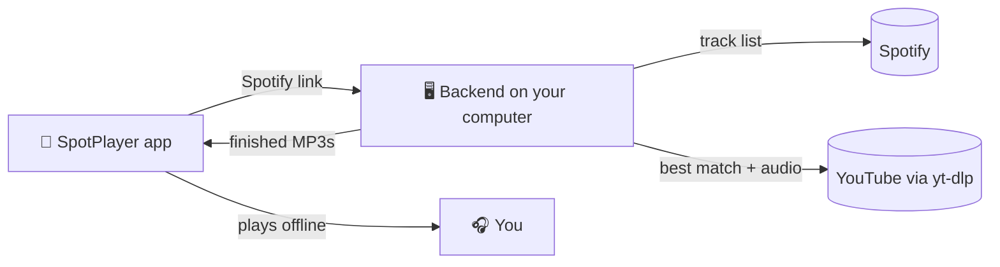

<div align="center">
  <h1>🎶 SpotPlayer</h1>
  <p><b>If you are a developer and still paying to listen to music, then this is for you. Thank me later... 🚀</b></p>
  
  <p>
    <a href="https://flutter.dev"></a>
    <a href="https://fastapi.tiangolo.com/"></a>
    <a href="https://www.docker.com/"></a>
    <a href="https://www.python.org/"></a>
    
  </p>
  
  <h3><a href="SpotPlayer.apk">📲 Download APK (24MB)</a></h3>
</div>

---

## ✨ Why SpotPlayer?
You're a dev. You can spin up a Docker container in your sleep. So why are you still paying Spotify every month? 💸

Paste a link → your own backend grabs the songs → they live on your phone forever. No ads, no subscription, no internet needed. 🎧

## 🚀 Features That Wow

- 📥 **One-Click Imports:** Just paste a playlist, album, or track link. SpotPlayer handles the rest.
- 🎧 **True Offline Experience:** Music stays on your phone. No internet? No problem.
- ⚡ **Lightning Fast Downloads:** Powered by parallel Python workers in a Docker container.
- 🎯 **Smart Matching:** Prefers official uploads and skips covers, live versions, remixes, and lyric videos.
- 📱 **Native Integration:** Full background play, Android Auto support, lock-screen media controls, AirPods support, and an interactive Android home widget.
- 🧠 **Smart Memory:** Remembers your exact position and queue after closing the app.

---

## 🧩 How It Works

<p align="center">
  
</p>



---

## 🛠️ Tech Stack

SpotPlayer is a beautiful marriage of modern technologies:
- **Frontend App:** [Flutter](https://flutter.dev/) (Dart) using Riverpod for robust state management.
- **Local Backend Engine:** [FastAPI](https://fastapi.tiangolo.com/) (Python) running seamlessly in a [Docker](https://www.docker.com/) container.
- **Audio Processing:** [yt-dlp](https://github.com/yt-dlp/yt-dlp) and FFmpeg, with matching logic that scores title, duration, and channel to pick the right song.

---

## 📋 Prerequisites

- An **Android phone**
- A computer (Mac, Windows, or Linux) with Docker installed and running:
  - **Mac:** [Docker Desktop for Mac](https://docs.docker.com/desktop/setup/install/mac-install/)
  - **Windows:** [Docker Desktop for Windows](https://docs.docker.com/desktop/setup/install/windows-install/)
  - **Linux:** [Docker Engine](https://docs.docker.com/engine/install/) with the Compose plugin
- Phone and computer on the **same Wi-Fi network**

---

## ⚙️ Quick Setup Guide

We’ve made setup as painless as possible. You only need your computer for the initial sync.

### Step 1: Install the App
Download **[SpotPlayer.apk](SpotPlayer.apk)** on your phone and install it.

### Step 2: Spin Up the Engine
Make sure Docker is running, then launch the backend from the project folder:

**Mac / Linux** (Terminal)
```bash
./start.sh
```

**Windows** (Command Prompt or PowerShell)
```bat
start.bat
```
*The terminal will print a shiny API URL (e.g., `http://192.168.1.42:8000/api`). Keep this handy!*

### Step 3: Sync & Play
1. Open SpotPlayer on your phone.
2. Go to **Settings → Server** and paste your API URL.
3. Tap the **+** button and paste any Spotify link.
4. Watch the magic happen, then hit **Play**! 🎉

*Once your songs are downloaded, press `Ctrl+C` on your computer. Your music is now safely in your pocket.*

<details>
<summary><b>👩‍💻 Build the app from source</b></summary>

```bash
cd app
flutter pub get
flutter build apk --release --split-per-abi --tree-shake-icons
```
Install `app/build/app/outputs/flutter-apk/app-arm64-v8a-release.apk` on your phone.

</details>

---

## 💡 Pro Tips

- **Reclaim Space:** Deleting a playlist automatically cleans up orphaned MP3 files, keeping your storage optimized.
- **Listen Stats:** Tap the insights icon in your library to see your listening stats and history.
- **Auto-Retry:** SpotPlayer automatically handles failed downloads, but you can always manually retry an entire batch with one tap.

---

## 🩺 Troubleshooting

<details>
<summary><b>The app says "Not reachable" / can't connect to the server</b></summary>

- Check that the phone and computer are on the **same Wi-Fi**.
- Campus, office, and hotel Wi-Fi often block devices from talking to each other. Use home Wi-Fi or a phone hotspot instead.
- Allow port **8000** through your computer's firewall:
  - **Mac:** System Settings → Network → Firewall → Options, and allow incoming connections for Docker.
  - **Windows** (PowerShell as Administrator):
    ```powershell
    netsh advfirewall firewall add rule name="SpotPlayer" dir=in action=allow protocol=TCP localport=8000
    ```
  - **Linux:**
    ```bash
    sudo ufw allow 8000/tcp
    ```
- Make sure the URL ends with `/api`, exactly as `start.sh` printed it.

</details>

<details>
<summary><b>Downloads suddenly started failing</b></summary>

YouTube changes things regularly, and yt-dlp ships fixes quickly. Rebuild the backend to get the newest yt-dlp:

**Mac / Linux**
```bash
docker compose build --no-cache
./start.sh
```

**Windows**
```bat
docker compose build --no-cache
start.bat
```
Without `--no-cache`, Docker reuses the old yt-dlp it already has.

</details>

<details>
<summary><b><code>start.sh</code> / <code>start.bat</code> fails with a Docker error</b></summary>

Docker must be installed and running before you start the backend.

- **Mac / Windows:** open Docker Desktop and wait until it says it is running, then try again.
- **Linux:** start the Docker service, then try again:
  ```bash
  sudo systemctl start docker
  ```

</details>

---

## ⚠️ Disclaimer

SpotPlayer is a personal project for personal use. Downloading audio from YouTube may break YouTube's Terms of Service. Please support the artists you love.

<div align="center">
  <br/>
  <b>Stop renting your music. Own it. Thank me later 😎🎶</b>
</div>
